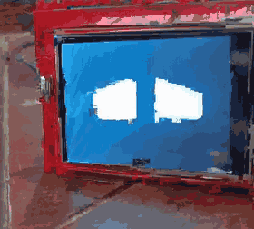
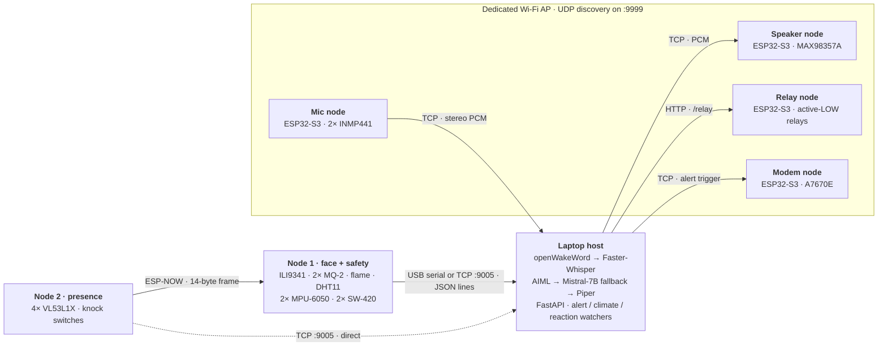
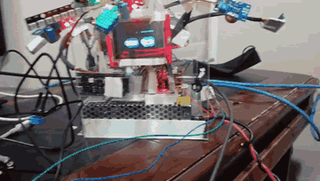
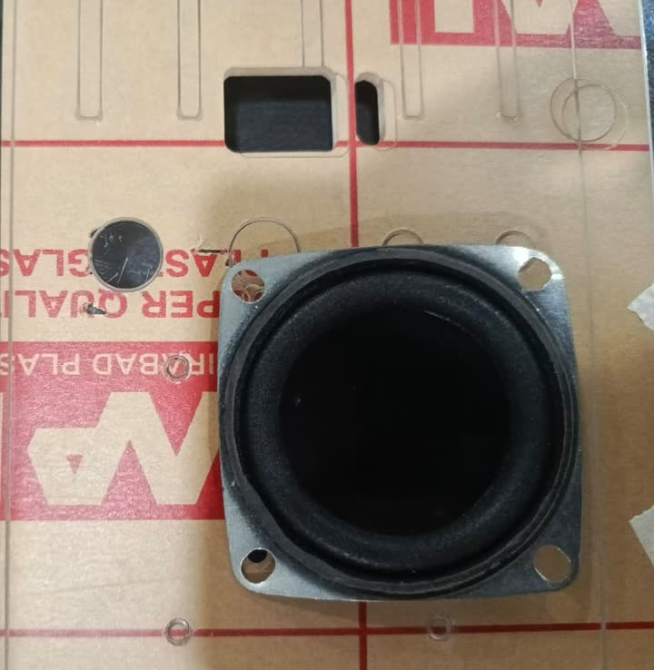

<div align="center">

# GENIE

**Generate, Engage, Navigate Intelligent Environments**

An offline voice assistant and home-safety monitor built from six ESP32-S3 nodes and one laptop.<br/>
Wake word, speech recognition, intent routing and speech synthesis all run locally. No audio, transcript or telemetry leaves the network.



Final-year project · BS Artificial Intelligence · University of Management and Technology, Lahore · Nov 2025 – Sep 2026

[](https://github.com/ArmanAdilMangat/GENIE/actions/workflows/checks.yml)
[](LICENSE)

</div>

---

## What it is

Commercial voice assistants send household audio to a cloud, stop working when the internet does, and sell safety monitoring as a separate subscription. GENIE puts both jobs in one device and keeps everything local.

It was built for people for whom reaching a light switch is not a small thing: appliances are switched by voice, the device reports its state through an animated face that can be read from across a room, and smoke, flame and fall events raise an alert without anyone asking.

- **Voice path.** A custom "Hey Genie" wake word gates capture from two microphones. Faster-Whisper transcribes both channels and the clearer transcript wins. Device commands resolve through a deterministic AIML layer; only unmatched, non-sensor questions fall back to Mistral-7B running under Ollama. Piper speaks the reply.
- **Safety path.** Gas, flame, fall and vibration are confirmed on the microcontroller and never pass through the speech or language models. A sensor that cannot be read reports `unknown`, which can neither raise an alarm nor produce an all-clear.
- **On-device learning.** A 232-parameter classifier runs on the face board itself, in plain MicroPython, to recognise when the unit is being tapped, pushed, picked up or shaken.

> **Scope of this repository.** The host pipeline, the firmware for five of the six boards, the enclosure and the engineering record are here and run. Three things the project report describes are not: the relay node's firmware, the training stack and dataset behind the on-device classifier, and four of the five test suites. They were not in the code this repository was assembled from. Figures that depend on them are marked as report figures; [`docs/STATUS.md`](docs/STATUS.md) lists what was re-checked against the code and what was not.

## System



The hardware is split across six boards on purpose. One ESP32-S3 cannot drive two I2S audio streams, an 8-bit parallel display and a dozen sensors without pin conflicts, memory pressure and brown-outs; giving each board one job removed all three.

Two data paths run side by side and never touch:

| Path | Carries | Route | Time |
|---|---|---|---|
| **A · safety** | flame, fall, gas, presence | confirmed in firmware → telemetry line → alert decision | 50–150 ms for flame and fall; about 4 s for smoke (deliberate debounce) |
| **B · conversation** | speech in, spoken reply out | wake word → Faster-Whisper → AIML / Mistral-7B → Piper | 8–15 s |

Full description: [`docs/ARCHITECTURE.md`](docs/ARCHITECTURE.md).

## Measured results

Every figure is taken from the project report's results chapter. Where a number does not exist, the table says so.

| Component | Result | Notes |
|---|---|---|
| On-device handling classifier | **72.6 %** on a held-out recording session (679 windows) | 14→12→4 MLP, 232 parameters, pure MicroPython. A random split of one session gives 88.3 %; that figure is reported and not used |
| Confidence gate at 0.70 | 82.6 % correct on the 77.8 % of windows it answers | The board stays silent on the other 22.2 % |
| Weakest class | `picked_up` recall 24.1 % | An accelerometer cannot tell "held still in a hand" from "on a desk, being touched" |
| Wake word | fires at 0.65 sustained over 3 × 80 ms blocks | Custom model, 242 clips, 5 speakers. Bench: 9/10 at 2 m, 6/10 at 3 m |
| Speech recognition | Faster-Whisper base / int8 | Segments rejected above `no_speech_prob` 0.6 or below `avg_logprob` −1.0. **No word-error-rate evaluation was run** |
| Intent layer | 362 AIML patterns, 0 duplicates | All 24 conditionals in the sensor answer file carry a default branch |
| Automated tests | 104 assertions, 5 suites (report figure) | Four of the five suite files are not in this repository. CI runs 15 alert-policy tests written for it, the module self-tests, the AIML audit, the frame round-trip and the enclosure audit |
| Display | 2,477 kpx/s fill, 118 fps eye-engine soak | Hand-written 8080 parallel driver using `@micropython.viper` |
| Backlog | 21 of 29 items complete | 5 more are implemented and blocked by something outside the software; 3 were never started |

More detail, including the confusion matrix and the path from 31.4 % to 72.6 %: [`docs/RESULTS.md`](docs/RESULTS.md).

## What does not work

Stated plainly, because a demo hides these and a reviewer should not have to find them.

- **Presence array.** Each of the four VL53L1X sensors works alone. Brought up together they fail non-deterministically, a different subset each boot. A sagging 3.3 V rail is the best-supported explanation and it has not been measured. The array is not in the demonstration unit.
- **Emergency calling.** The SMS-then-call escalation is implemented. Autonomous calling was disabled after the modem's supply reset under the 2 A GSM transmit burst, and live validation still needs a SIM registered with the national regulator.
- **Fall detection.** The three-stage detector receives a sample roughly every 50 ms on hardware where it needs one every 20 ms, and it detects the device falling, not a person. Fall alerting is switched off in the shipped configuration: a confirmed fall is recorded and answered when asked, and raises no alert.
- **Gas readings.** The MQ-2 baseline has not been calibrated against a real combustion source.
- **Wake-word false accepts.** About one activation per minute in a room with ongoing conversation.
- **Beamforming.** Delay-and-sum across the two microphones gave no measurable improvement in range or false-accept rate. It is recorded as unproven, not as a feature.
- **Not built.** Sign-in web dashboard and battery operation.

Current state by subsystem: [`docs/STATUS.md`](docs/STATUS.md).

## Engineering notes worth reading

| Note | One line |
|---|---|
| [The frame that could never have worked](docs/fault-records/espnow-frame-size.md) | One side packed 10 bytes, the other checked for 12, and every frame vanished without an error on either board |
| [A working handshake is not a working sensor](docs/fault-records/tof-array-bringup.md) | Four genuine sensors, a clean bus, and an array that still would not start |
| [The fingerprint reader that was condemned, then enrolled a user](docs/fault-records/r307s-fingerprint.md) | A fault tree, and the evidence that later contradicted it |
| [One wire, forty times less noise](docs/fault-records/mq2-ground-reference.md) | Why the gas reading swung ±25 % in clean air |
| [Two days on a white screen](docs/fault-records/tft-data-pin-order.md) | The display shield's data pins are not in numeric order |
| [What the first laser cut got wrong](enclosure/TEST_CUT_POSTMORTEM.md) | Five faults, each traced to a dimension nobody had measured |
| [Lessons](docs/LESSONS.md) | The traps already paid for, in one page |

## Repository map

```
firmware/
  link/               the three files both sensor boards must share: ESP-NOW frame, Wi-Fi uplink, network template
  node1_face/         face, sensors, display driver, telemetry, on-device classifier, per-sensor benches
  node2_presence/     ToF array, knock input, calibration, diagnostic bench
  audio_nodes/        microphone node and speaker node
  modem_node/         A7670E emergency node
  r307s_fingerprint/  verification suite and driver — investigated, not in the final system
host/
  api.py              sensor store, relay control, telemetry listener, UDP discovery
  AudioServer.py      capture, wake word, voice-activity detection
  config.py           every setting and the reason for it
  relay.aiml  sensor.aiml  hey_genie.onnx
  Services/           speech pipeline, alert / climate / reaction watchers, board simulator, monitor
  tests/              alert-policy regression tests, fake clock, no board
tools/                syntax, AIML and credential checks run by CI
enclosure/            parametric DXF generator, independent audit, cut files, post-mortem
docs/                 architecture, results, status, hardware, protocol, bring-up, fault records
legacy/phase1/        the first prototype: one ESP32-S3, Flask, Whisper, pyttsx3
```

## Run the checks

No hardware is needed for any of these.

```bash
# the ESP-NOW frame round-trips and its size is derived, not assumed
python3 firmware/link/genie_link.py

# the AIML files are well-formed, have no duplicate patterns, and every condition has a default
python3 tools/check_aiml.py

# host self-tests: telemetry contract, board-to-API bridge, climate control, handling reactions
pip install requests aiml.py
cd host
python3 Services/genie_serial.py && python3 Services/node_bridge.py
python3 Services/climate_watch.py && python3 Services/reaction_watch.py
python3 tests/test_alert_policy.py       # edge, debounce, cooldown, unknown-is-not-clear
cd ..

# the enclosure cut file passes its 21-point audit
pip install -r enclosure/requirements.txt
python3 enclosure/verify_dxf.py enclosure/DESIGN_B_NO_TOF/GENIE_NO_TOF.dxf
```

## Try it without hardware

The sensor store, the alert policy and every deterministic answer run on a laptop against a simulated pair of boards.

```bash
cd host
pip install -r requirements.txt                  # Python 3.11 to 3.13
python api.py                                    # terminal 1
python Services/fake_node.py --scenario blind    # terminal 2: every safety sensor unreadable
python Services/sensor_monitor.py                # terminal 3
```

Twelve scenarios, four of them failure cases. Installing the full speech pipeline: [`docs/SETUP.md`](docs/SETUP.md). Flashing and wiring the boards: [`docs/BRING_UP.md`](docs/BRING_UP.md) and [`docs/HARDWARE.md`](docs/HARDWARE.md).

## Hardware

<table>
  <tr>
    <td width="50%"></td>
    <td width="50%"></td>
  </tr>
  <tr>
    <td align="center"><sub>Bench rig: face, then one sensor filling the screen</sub></td>
    <td align="center"><sub>Speaker and microphone laid on the cut panels during fit checks</sub></td>
  </tr>
</table>

The enclosure is a 177.8 mm cube in 3 mm clear cast acrylic, 14 pieces from 11 unique parts, with a back panel that slides out in glued rails. It is generated from one Python script and audited by another before every cut: [`enclosure/`](enclosure/).

## Team

| Member | Built |
|---|---|
| **Arman Adil Mangat** · [GitHub](https://github.com/ArmanAdilMangat) · [LinkedIn](https://www.linkedin.com/in/armanadilmangat) | Lead developer. Sensor nodes and their firmware, the inter-node link and telemetry contract, display driver and face, AIML pattern files, wake-word corpus, enclosure design and fabrication. Integration, jointly |
| **Muhammad Suhaib Mamoon** · [GitHub](https://github.com/Suhaib580) | The host pipeline in `host/`: wake word, capture, transcription, intent routing with the language-model fallback, synthesis and speaker streaming, FastAPI backend, alert, climate and reaction watchers, board simulator. Cellular module, jointly with Farhal. Integration, jointly |
| **M. Farhal Raza** | IoT relay box: firmware and wiring for the appliance-control node. Cellular module, jointly with Suhaib |
| **Muhammad Huzaifa Furqan** | Project documentation |

Supervisor: **Mr. Mahmood Hussain**, Department of Artificial Intelligence, UMT Lahore.

Details in [`CONTRIBUTORS.md`](CONTRIBUTORS.md).

## License

MIT — see [`LICENSE`](LICENSE). Third-party origins are listed in [`THIRD_PARTY_NOTICES.md`](THIRD_PARTY_NOTICES.md).

GENIE is a student project and a demonstrator. It is not a medical device, a certified alarm or a substitute for either.
