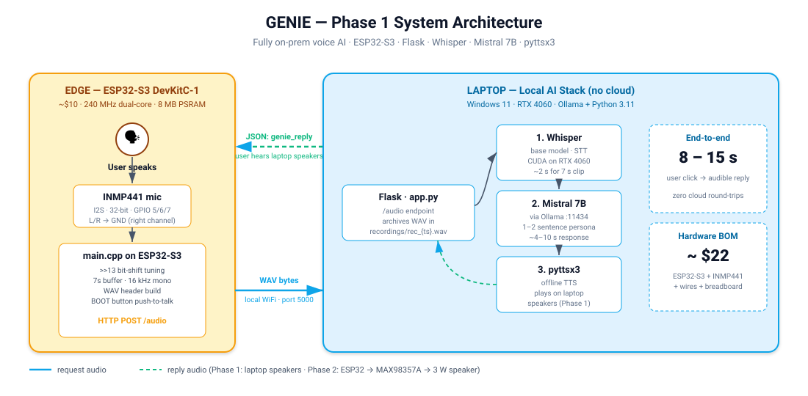
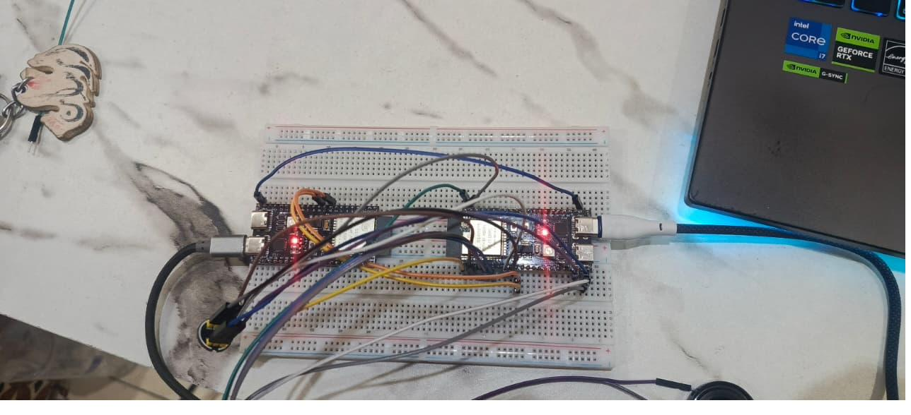
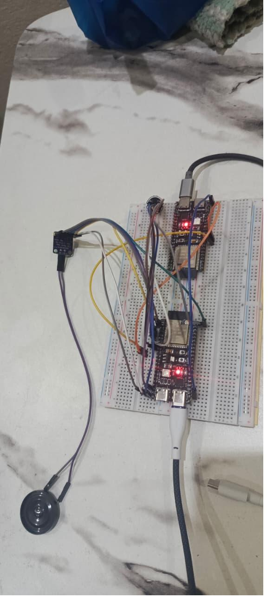

<div align="center">

# 🧞 GENIE

### **G**enerate, **E**ngage, **N**avigate **I**ntelligent **E**nvironments

**A fully offline voice AI assistant that runs on a $22 ESP32-S3.**
*No cloud. No API keys. No data ever leaves your network.*

[](LICENSE)


</div>

---

## ✨ What it does

You press a button. You talk. A 240 MHz dual-core ESP32-S3 streams 16 kHz mono PCM
over your local WiFi to a Flask server on your laptop. **OpenAI Whisper** transcribes
it on a CUDA RTX 4060. **Mistral 7B** running locally via **Ollama** thinks about it.
**pyttsx3** speaks the reply back. End-to-end: **8 – 15 seconds**, completely on-prem.

GENIE is the final-year project of four AI students at the University of Management
and Technology, Lahore. It was built as an **accessibility-first** voice interface
for physically impaired users — a private, offline alternative to Alexa, Google
Assistant, and Siri that doesn't phone home.

---

## 🏗️ Architecture



Two containers talking to each other over your WiFi:

1. **`firmware/`** — the ESP32-S3 client. Push-to-talk, capture, WAV-pack, HTTP POST.
2. **`server/`** — the Flask bridge that wires Whisper → Mistral → pyttsx3 together.

See [`docs/wiring.md`](docs/wiring.md) for the full pin map and signal-conditioning notes.

---

## 📊 Phase 1 results

| Metric | Value |
| --- | --- |
| User stories completed | **16 / 16** ✅ |
| Critical bugs resolved | **10 / 10** ✅ |
| End-to-end latency | **8 – 15 s** (user click → audible reply) |
| Hardware BOM | **~$22** total |
| Cloud calls per query | **0** — fully on-prem |
| Audio quality | 16 kHz mono · 16-bit PCM |
| Max utterance length | 7 s per turn (configurable) |
| Power source | Single USB-C (laptop → dev board) |

---

## 🔧 Hardware

| Component | Qty | Approx. cost | Role |
| --- | :-: | :-: | --- |
| ESP32-S3 DevKitC-1 (N16R8) | 1 | $10 | MCU + WiFi + PSRAM |
| INMP441 I2S MEMS microphone | 1 | $4 | 24-bit digital audio capture |
| Solderless breadboard + jumper wires | — | $5 | Prototyping |
| USB-C cable | 1 | $3 | Power + serial monitor |
| **Total** | | **~$22** | |

<table>
  <tr>
    <td align="center" width="50%">
      
      <br><sub><b>Early breadboard prototype</b></sub>
    </td>
    <td align="center" width="50%">
      
      <br><sub><b>INMP441 wired to GPIO 5/6/7</b></sub>
    </td>
  </tr>
</table>

---

## 💻 Software stack

| Layer | Tool | Why |
| --- | --- | --- |
| Speech-to-text | OpenAI **Whisper** (base model) | Best-in-class accuracy for noisy room audio; runs locally on GPU |
| Language model | **Mistral 7B** via **Ollama** | 7 B params fits comfortably on an RTX 4060; permissive license |
| Text-to-speech | **pyttsx3** | Offline, cross-platform, no SaaS dependency |
| Bridge | **Flask** | Smallest sensible HTTP surface for an embedded client |
| Firmware | **Arduino-ESP32** / **PlatformIO** | First-class I2S driver, mature ecosystem |

---

## 🚀 Getting started

### 1. Server (laptop)

```bash
# 1) Install Ollama and pull Mistral
#    https://ollama.com/download
ollama pull mistral

# 2) Set up the Python server
cd server
python -m venv .venv
source .venv/bin/activate           # Windows: .venv\Scripts\activate
pip install -r requirements.txt

# 3) Run the server (port 5000, listens on all interfaces)
python app.py
```

> **ffmpeg required** — Whisper uses ffmpeg under the hood. On Windows, install
> from [ffmpeg.org](https://ffmpeg.org/download.html) and add it to your `PATH`.

Find your laptop's local IP — you'll need it for the firmware:

| OS | Command |
| --- | --- |
| Windows | `ipconfig` → look for **IPv4 Address** |
| macOS / Linux | `ifconfig` or `ip addr` → look for **inet** |

### 2. Firmware (ESP32-S3)

```bash
cd firmware

# Copy the secrets template and fill in your WiFi + Flask IP
cp include/secrets.h.example include/secrets.h
$EDITOR include/secrets.h

# Build, flash, and open the serial monitor
pio run -t upload
pio device monitor -b 115200
```

In the serial monitor you'll see GENIE's interactive menu. Press the **BOOT** button
on the dev board (or type `r` and hit Enter) to record a query.

```
╔════════════════════════════════════╗
║         GENIE Voice Assistant      ║
╠════════════════════════════════════╣
║  🎤 BOOT btn / 'r' → Start record  ║
║  ⏹️  's'           → Stop recording ║
║  ⏸️  'p'           → Pause / Resume ║
╠════════════════════════════════════╣
║  🔬 COMPONENT TESTS:               ║
║  'm' → Test Mic                    ║
║  'w' → Test WiFi                   ║
║  'f' → Test Flask server           ║
║  'g' → Test Genie AI (Ollama)      ║
║  'a' → Test ALL components         ║
╚════════════════════════════════════╝
```

---

## 🧠 Engineering problems we had to solve

A short tour of the four headaches that ate the most days. Full write-ups are in the
[Phase 1 FYP submission](docs/) (PDF coming soon).

### 1. INMP441 bit-shift tuning — `>>13` was the magic number

The INMP441 emits 24-bit samples padded into a 32-bit I2S frame. Right-shifting by
too little caused clipping on normal speech; too much lost dynamic range in quiet
speech. After A/B testing values from `>>10` to `>>16`, **`>>13`** gave the cleanest
signal-to-noise for typical conversational volume in a quiet room. The firmware
uses `>>16` for the audio path (truncating to upper 16 bits) and `>>14` for the
metering display so the peak number stays readable.

### 2. Ghost-voice distortion — fixed by resampling 22050 → 16000 Hz

`pyttsx3` on Windows emits 22050 Hz audio by default. When the Phase 2 work-in-progress
returned that WAV to the ESP32 (which expects 16 kHz exactly), playback came out
chipmunk-pitched and metallic. Resampling on the server with `audioop.ratecv()`
before sending downstream eliminated the artifact. *(This fix lives in the Phase 2
branch; Phase 1 ships the laptop-speaker path that doesn't need it.)*

### 3. PSRAM overflow — 480 KB audio buffer wouldn't fit in DRAM

At 16 kHz × 16-bit × 15 s the speech buffer alone is 480 KB. ESP32-S3 DRAM is only
~320 KB after the WiFi stack initializes. The fix: limit Phase 1 to a 7 s buffer
that fits in DRAM (224 KB), and move to a `ps_malloc()` PSRAM-backed buffer in
Phase 2 once the longer-utterance use case landed.

### 4. WiFi audio crackle — the missing 100 µF capacitor

When the WiFi radio TX-bursted during streaming, the 3 V3 rail dipped enough to
modulate the I2S clock, producing audible clicks. A 100 µF electrolytic across the
mic's VDD/GND pins absorbed the transient and the crackle disappeared. Embedded AI
is half ML, half power supply design.

---

## 🛣️ Roadmap

| Phase | Status | Highlights |
| --- | :-: | --- |
| **Phase 1** — Laptop reply | ✅ Complete | Whisper + Mistral + pyttsx3, 16/16 user stories |
| **Phase 2** — On-device reply | 🚧 In progress | ESP-NOW peer-to-peer ✅, dual-mic stereo ✅, soldered PCB ✅, MAX98357A + 3 W speaker ✅, Whisper-small upgrade ✅, IoT control ✅. *Remaining:* "Hey Genie" wake-word, web dashboard with sign-in, 18650 battery operation |
| **Phase 3** — Untethered AI | 📋 Planned | On-device inference (esp-dl quantized models), multi-language (English / Urdu / Mandarin) |

---

## 👥 Team

| Member | Role |
| --- | --- |
| **Arman Adil Mangat** ([@ArmanAdilMangat](https://github.com/ArmanAdilMangat)) | Team Lead · Hardware · Firmware · System integration |
| Muhammad Suhaib Mamoon | AI pipeline · Flask server |
| Muhammad Huzaifa Furqan | Firmware · Component testing |
| Muhammad Farhal Raza | Documentation · Integration QA |
| **Supervisor:** Mahmood Hussain | Department of Artificial Intelligence, UMT Lahore |

---

## 🙏 Acknowledgments

GENIE stands on the shoulders of open-source giants. None of this would be
buildable by a team of four undergrads without:

- [OpenAI Whisper](https://github.com/openai/whisper)
- [Mistral AI](https://mistral.ai/) and the [Ollama](https://ollama.com/) team
- The [Espressif ESP-IDF](https://github.com/espressif/esp-idf) and Arduino-ESP32 cores
- [pyttsx3](https://github.com/nateshmbhat/pyttsx3) and the long lineage of offline TTS engines

---

## 📄 License

GENIE is released under the [MIT License](LICENSE). You are free to use, modify, and
redistribute it for any purpose, including commercial work.

---

<div align="center">

**Built with ☕ and a soldering iron in Lahore, Pakistan 🇵🇰**

*If GENIE helped you build something, a ⭐ on the repo is the only payment we ask for.*

</div>
