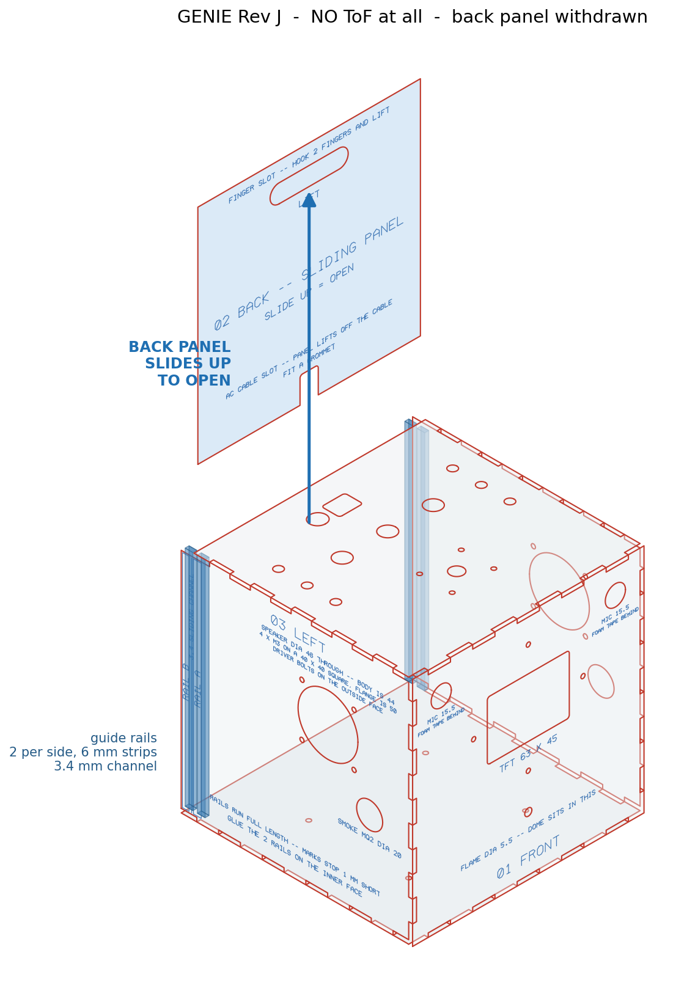
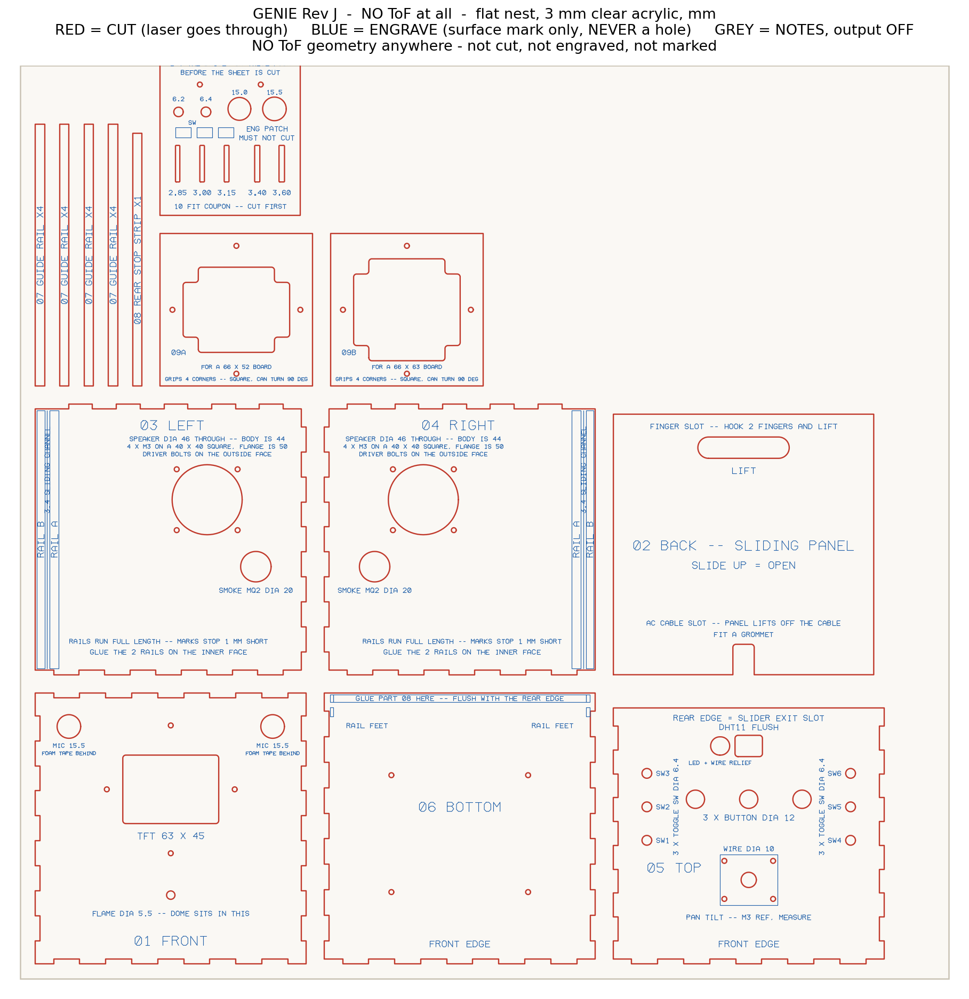
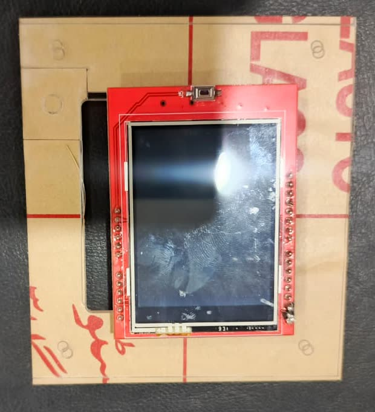

# Enclosure — Rev J

A 177.8 mm (7 in) cube in 3.0 mm clear cast acrylic, laser-cut as **14 pieces from 11 unique parts**, with a back panel that slides straight up and out in glued 6 mm rails. Clear on purpose: the wiring is meant to be seen.

The whole thing is generated by one Python script and checked by another. Nothing here was drawn by hand.

<p>
  
  
</p>

## Files

| Path | What |
|---|---|
| `DESIGN_B_NO_TOF/GENIE_NO_TOF.dxf` | **The file to cut.** Full sheet, all 14 pieces |
| `DESIGN_B_NO_TOF/GENIE_NO_TOF_blackred.dxf` | Same geometry with cut = black and engrave = red, for controllers that will not take red / blue. Cut one, never both |
| `PARTIAL_CUTS/` | The same geometry nested for smaller stock: side panels only, replacement panels, the fit coupon alone, and a first test cut |
| `genie_case_final.py` | The generator. One `CFG` dictionary drives every dimension |
| `verify_dxf.py` | An independent 21-point audit of a generated file |
| `render_final.py`, `make_partial.py`, `strokefont.py` | Previews, partial nests, and the single-stroke label font |
| `VERIFICATION_REPORT.txt` | Audit output for the released file |
| [`TEST_CUT_POSTMORTEM.md`](TEST_CUT_POSTMORTEM.md) | What the first physical cut got wrong, and why |
| [`REVISIONS.md`](REVISIONS.md) | Revision history |
| `recut_2026-09-03/` | Three replacement plates issued after Rev J — see the revision history |

## Regenerate and audit

```bash
pip install -r requirements.txt

python3 genie_case_final.py       # writes DESIGN_B_NO_TOF/ and DESIGN_A_WITH_TOF_HOLES/
python3 render_final.py           # previews
python3 make_partial.py           # PARTIAL_CUTS/
python3 verify_dxf.py DESIGN_B_NO_TOF/GENIE_NO_TOF.dxf
```

The generator reproduces the committed cut file exactly, apart from the timestamp lines in the DXF header. `CFG['TOF_CUT']` is the single flag that separates the two variants; the variant with time-of-flight apertures is a fallback and is not committed.

Run the audit before every cut. It fails the file if any cut path is open, self-crossing or drawn twice, if a part is the wrong size or outside the sheet, if a tab has no matching notch on its mating panel, or if any engraved mark comes within 0.30 mm of a cut line.

## Machine conventions

AutoCAD R12 (AC1009), millimetres, `POLYLINE` and `CIRCLE` entities only, an explicit colour on every entity, and all labels drawn as stroke polylines because common laser software does not render DXF text.

| Layer | Colour | Meaning |
|---|---|---|
| `CUT` | Red (ACI 1) | Through cut. The only layer that is cut |
| `ENGRAVE` | Blue (ACI 5) | Surface mark only — never a hole |
| `NOTES` | Grey (ACI 8) | Title block. **Set its output off** |

Laser controllers build their layer table from colour, not layer name. The first thing to tell an operator is that grey is not geometry.

Kerf was measured at 0.178 mm. It is documented in the configuration and deliberately not applied; fits are set by the coupon instead.

## Parts

| No. | Part | Size (mm) | Qty | Carries |
|---|---|---|---|---|
| 01 | Front | 177.8 × 177.8 | 1 | Display window, 4 × M3 frame bolts, 2 × microphone Ø15.5, flame Ø5.5 |
| 02 | Back slider | 171.0 × 171.2 | 1 | Cable U-slot, 60 × 14 finger slot |
| 03 | Left | 174.8 × 171.8 | 1 | Speaker Ø46 with 4 × M3, MQ-2 Ø20 |
| 04 | Right | 174.8 × 171.8 | 1 | Mirror of 03 |
| 05 | Top | 177.8 × 165.0 | 1 | 3 × button Ø12, 6 × toggle Ø6.4, DHT11 window with relief, wire pass Ø10 |
| 06 | Bottom | 177.8 × 174.8 | 1 | 4 × M3 deck mounts |
| 07 | Guide rail | 6.0 × 171.8 | 4 | Two per side panel, inner face |
| 08 | Rear stop strip | 6.0 × 165.8 | 1 | On the bottom, between the rear rails |
| 09A | Display clamp frame A | 100 × 100 | 1 | Cross opening for a 66 × 52 board |
| 09B | Display clamp frame B | 100 × 100 | 1 | Cross opening for a 66 × 63 board |
| 10 | Fit coupon | 92 × 134 | 1 | Cut this first, on scrap |

The job occupies 567.4 × 635.6 mm of a 610 × 915 mm sheet.

**03 and 04 are mirrors, not duplicates**, and the left panel's top-edge finger pattern is asymmetric. A flipped left panel will not meet the top.

### Feature positions

Panel-local, bottom-left origin, viewed from outside.

```
01 FRONT   display window  63 x 45 R2        88.9 , 114.5
           frame bolts     4 x M3 (3.2)      46.9 / 130.9 , 114.5
                                             88.9 , 72.5 / 156.5     on the axes
           microphones     2 x dia 15.5      22.0 and 155.8 , 155.8
           flame           dia 5.5           88.9 , 45.0
03 / 04    speaker         dia 46 through    a 62 , v 112
           flange bolts    4 x M3 (3.2)      a 42 / 82 , v 92 / 132
           MQ-2            dia 20            a 30 , v 68
05 TOP     buttons         3 x dia 12        53.9 / 88.9 / 123.9 , 105
           toggles         6 x dia 6.4       22.0 / 155.8 , 78 / 100 / 122
           DHT11           18 x 14 R2        88.9 , 140
           DHT11 relief    12.5 x 12 R2      70.2 , 140     LED, header and wires
           wire pass       dia 10            88.9 , 52
02 BACK    cable U-slot    14 x 20           bottom edge, centre
           finger slot     60 x 14 R7        85.5 , 149.2
06 BOTTOM  deck mounts     4 x M3 (3.2)      44 / 133.8  x  44 / 120.8
09A / 09B  100 x 100, cross opening, 4 x M3 on the axes at +/-42
```

## The display clamp frame

The display shield has pin headers down both long edges and a button on a third, so no straight-edge clamp can touch it without landing on a connector. The opening is therefore a **cross**, leaving material only as four 8 × 8 mm pads on the board's corners — the one place a PCB carries nothing.

Two plates are cut because the shield's short side was never settled: one reading gave 63 mm, a photo scaled against a known edge gave about 52 mm. The plates are square with their bolts on the axes, so either can also be turned 90° for a portrait board. One spare 100 mm offcut buys certainty.



## The sliding back

Measured in *y* from the front face:

```
front rail    162.4 – 168.4    6 mm strip
channel       168.4 – 171.8    3.40 mm  (3.0 panel + 0.4 clearance)
rear rail     171.8 – 177.8    6 mm strip, flush with the rear face
```

There is no machined groove. The channel is set entirely by where the strips land on their engraved footprints, so nothing depends on cut depth. The top panel stops 12.8 mm short of the rear face; that gap is the exit slot, and it vents the box. Withdrawing the panel completely needs about 180 mm of headroom.

Joints are finger joints, five tabs per edge, with the female half cut into the part outline — adding it as a separate rectangle on the edge burns every tab twice.

## The fit coupon

Part 10 is cut on scrap before the sheet. It turns an assumption about kerf into a measurement, for a few minutes and an offcut. It gauges seven things:

1. Joint slots at 2.85 / 3.00 / 3.15 mm. If two feel acceptable take the tighter: cement fills a tight joint by capillary action and does not fill a loose one.
2. Channel slots at 3.40 / 3.60 mm, for the sliding panel.
3. Three engrave patches. They must come out as a mark. If one goes through, the engrave layer has been set up as a cut — stop.
4. Toggle holes Ø6.2 / Ø6.4.
5. Microphone holes Ø15.0 / Ø15.5.
6. Flame hole Ø5.5.
7. The speaker bolt square, 40 × 40. Lay the real driver on all four.

A correct cut on cast acrylic leaves a clear, glossy edge. Frosted means the settings are wrong.

## Assembly

1. Coupon on scrap; check all seven gauges.
2. Cut the sheet, peel the film, sort by engraved part number.
3. **Glue the four rails to the side panels while they are flat**, both panels side by side so the channels end up parallel. This is the only step where accuracy matters.
4. Check that a 3 mm offcut drops through each channel before the cement sets.
5. Dry-fit bottom → sides → front → top. Tabs finish flush.
6. Cement the five fixed panels against a set square.
7. Glue the rear stop strip to the bottom on its engraved footprint.
8. Matte black vinyl inside, around the display window.
9. Each microphone goes into its hole from behind and is **taped**: Ø15.5 is a clearance hole, not a press fit. Closed-cell foam, never rigid standoffs.
10. Flame sensor dome into the Ø5.5 from behind.
11. Speakers bolt to the **outside** faces through the four flange holes, foam gasket between flange and acrylic, nylon washers under the nuts.
12. Offer the display shield to both clamp frames and keep the one whose corner pads land on the board. Sandwich the shield between the front panel and that plate.
13. Mount the boards, fit the toggles in the lid, wire them before the lid goes on.
14. Drop the back panel in through the top-rear slot.

## Traps

- **M3 through 3 mm acrylic.** Nylon washer under every nut, finger-tight plus a quarter turn. Over-torque cracks the sheet.
- **The speaker magnet sits about 20 mm inside the box.** Keep the board deck out of that cylinder on both sides.
- **Toggle bodies hang about 20 mm below the lid.** Keep the deck clear of those columns or the lid will not seat.
- **The DHT11 sits flush in its window.** Behind the panel it measures the box, not the room.
- **All cut-out corners are R2.** A sharp internal corner in acrylic is where a crack starts.
- **Mains inside a clear box.** Grommet the cable slot, sleeve the mains pair, earth the supply chassis, and keep mains away from the microphone lines.
- **Nothing in front of a time-of-flight lens.** This is why the released design has no apertures or windows for them at all.
