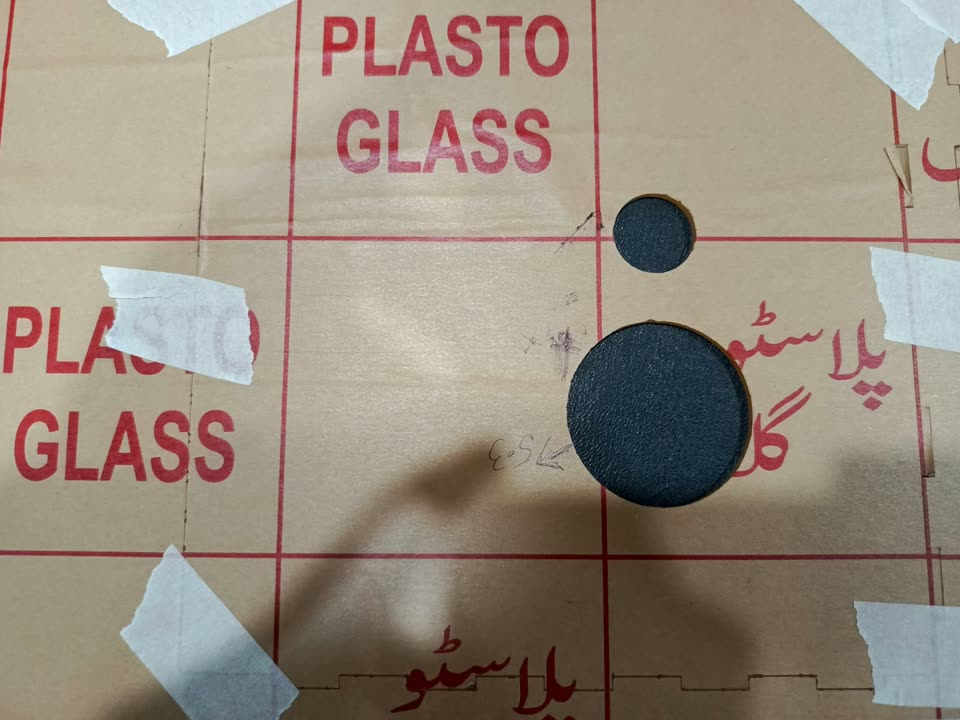
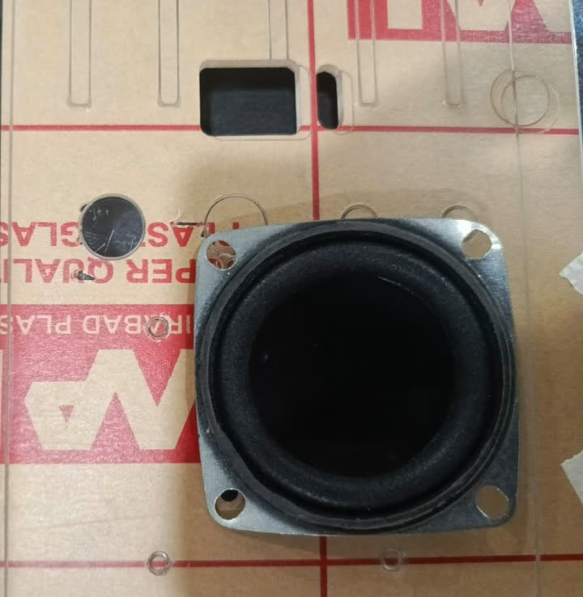
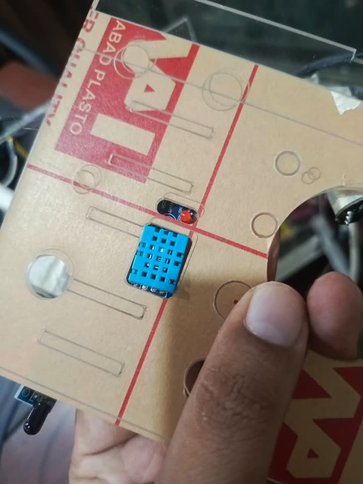
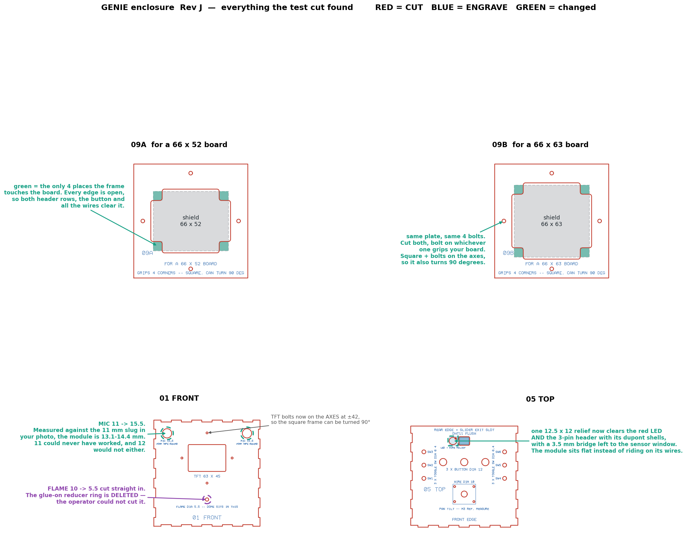

# What the first cut got wrong

A physical test cut was made on 29 August 2026. It found five faults. Rev J is those five fixed. This is the post-mortem, written before the final cut.

## The five faults, by cost

### 1. Nominal fits — three times, on the same part

The microphone hole went Ø9, then Ø11, then Ø12. None of them took the module.

Each time the hole was set to the number someone believed the part was, with no clearance on top. Ø9 was a guess. Ø11 came from "the module is 11 mm", which put an 11 mm part in an 11 mm hole. Ø12 added a millimetre to a number that was itself wrong. Measured against the Ø11 slug in a photograph of the test cut, the round INMP441 board is **13.1–14.4 mm**. It was never 11.

> **Rule.** Any hole a part must *enter* gets real clearance over a *verified* measurement — never a nominal match, never a number quoted from memory. Where the measurement is disputed, the hole goes to the recoverable side. A hole slightly too large is fixed with foam tape in thirty seconds. A hole slightly too small cannot be fixed.

The hole is now Ø15.5.

### 2. Designing three times around a dimension nobody had measured

The display shield's outline was never measured, and three clamp frames were built on three assumptions.

| Rev | Assumed | Result |
|---|---|---|
| E / F | The shield bolts to the panel through its own holes | Hole pattern unknown; abandoned |
| G / H | The shield is wider than a 63 × 62 opening | On the test cut it sat *inside* the opening and fell through |
| J | 66 × 52 from a scaled photo; 65 × 63 by hand | Both are on the sheet |

Rev J stops arguing. Two frames on identical square plates with identical bolt patterns; cut both and bolt on whichever grips.

### 3. Building to a stated number that the part contradicted

A Ø53 speaker hole was specified and drawn. The driver's own dimensions — body 44 mm, flange 50 mm square, bolt centres 57 mm on the diagonal — show that Ø53 is wider than the flange across its flats: the driver would have hung on four bolts over an open hole, with the bolt holes on the cut edge. It was reversed to Ø46, at the cost of a revision.

Ø46 gives 1 mm of relief around the body, 2 mm of flange bearing at the flats, and 3.7 mm of acrylic between the sound hole and each bolt. The bolt square is 40 × 40 mm because 40 × √2 = 56.57 mm, matching the measured diagonal.

> **Rule.** When a stated number and the physical part disagree, the part wins — and the arithmetic is written down once, so the question is not reopened.

It was the one aperture on the test cut that fitted first time.

### 4. A part the shop could not make

The flame sensor needed a Ø5 hole, and the design supplied it as a separate 20 × 20 mm reducer ring glued over a Ø10 hole. Correct in principle and impossible in practice: a piece that small drops through the laser's honeycomb bed. The operator could not cut it.

It was deleted. The hole is now Ø5.5 cut straight into the front panel.

> **Rule.** No part smaller than about 40 mm on a side. If a feature must be small, it belongs *in* a panel.

### 5. Testing last

The first full sheet was cut before a single component had been offered up to a hole. The test card should have been the first thing on the machine. It cost one sheet and about a week.

Related: engraved labels drift onto cut lines with every edit. The audit caught eight such collisions across four revisions. That is the audit doing its job, and every one was avoidable — labels now go only into dead zones by construction, and the audit fails any file where blue comes within 0.30 mm of red.

## What the test cut proved

| Feature | Result |
|---|---|
| Speaker Ø46 with 4 × M3 on a 40 × 40 square | Fits |
| DHT11 window 18 × 14 | Fits; its LED was half covered and its header held the module off the lid |
| Microphone Ø11 | Fails — the module is 13–14.4 mm |
| Display frame, 63 × 62 opening | Fails — the board sits inside it |
| Flame reducer ring | Could not be cut |
| Toggle Ø6.4, button Ø12, finger slot | No complaint |

That is what a test cut is for. Nothing on the list is a surprise any more, and none of it costs a sheet.

  
  

## What changed for Rev J

| | Was | Now | Why |
|---|---|---|---|
| Microphone | Ø12 | **Ø15.5** | Module measures 13.1–14.4 mm; recoverable side |
| Display frame | One 108 × 96 plate, 63 × 62 opening | **Two 100 × 100 plates with a cross opening and four corner pads** | Board size disputed; both readings cut |
| Frame bolts | ±44 / ±37 | **Four on the axes at ±42** | Symmetric, so a frame can turn 90° |
| DHT11 relief | 4.5 × 12 slot | **One 12.5 × 12 relief** | Clears the LED, the 3-pin header and the wires |
| Flame | Ø10 plus a glued ring | **Ø5.5 direct** | The ring could not be cut |
| Speaker | Ø46 with 4 bolts | Unchanged | It fits |

Both variants pass the audit, 21 of 21.

