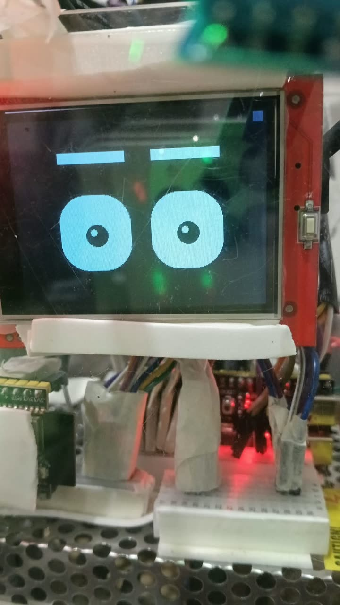

# Node 1 — face and safety sensing

An ESP32-S3 with a 2.4" ILI9341 display, two MQ-2 gas sensors, a flame sensor, a DHT11, two MPU-6050 IMUs, two SW-420 vibration switches, one push button and an 8-LED status strip. MicroPython.

The resting state is not a data readout. It is a face — brows, blinking, pupils that track the board's tilt — and numbers appear only when asked for. A device meant for someone with a physical impairment should say how things are at a glance from across the room.



## Layout

| Folder | Contents | Goes on the board? |
|---|---|---|
| `upload/` | The running modules | Yes, all of them, flat in the device root |
| `testing/` | One standalone bench script per sensor, `00` to `08` | Only while bench-testing |
| `tools/` | `doctor_all.py`, `i2c_doctor.py`, `cleanup.py` | Only when debugging |
| `WIRING.md` | Every wire on the board, generated from `pins.py` | — |

### `upload/`

| File | Role |
|---|---|
| `pins.py` | The pin map. `pins.report()` prints it; `pins.check()` fails on any collision with the display or the PSRAM pins |
| `ili9341_par.py` | ILI9341 over an 8-bit 8080 parallel bus. Hot loops use `@micropython.viper` and write GPIO registers directly |
| `eyes.py` | The face: six moods, each a preset of height, corner radius, eyelid coverage and colour, all tweened |
| `sensors.py` | One reader for every sensor. Each is polled on its own schedule and cached, so a read never blocks |
| `genie_ui.py` | Pages, the button, the main loop |
| `node1_report.py` | The telemetry emitter: one JSON line per tick to USB serial and, through `net_uplink`, to the host over TCP. Carries the self-check flags (`gas_ok`, `flame_ok`, `imu_ok`) that let the host tell a dead sensor from a quiet one |
| `fall_fsm.py` | Free-fall → impact → stillness state machine used by the integrated build |
| `handling_fsm.py` | Rule-based handling detector: the baseline the learned model is compared against |
| `har_features.py` | The 14-feature extractor, shared with the trainer so the two cannot drift |
| `har_model.py` | The exported 14→12→4 classifier, 232 parameters, with a 0.70 confidence gate and a feature-version guard |
| `genie_menu.py` | Diagnostics menu: rotation wizard, raw button view, live sensor table, bus scan |
| `fall_detect.py` | The original standalone three-stage fall detector, kept for the bench |
| `node1_link.py` | Receiving half of the ESP-NOW link from Node 2. Non-blocking |
| `main.py` | Autostart with a three-second escape hatch |

`genie_link.py` and `net_uplink.py` from [`../link/`](../link/) are uploaded alongside these, together with a `wifi_cfg.py` made from `../link/wifi_cfg.example.py`. Seventeen files on the device in all.

`genie_menu.py` is imported by nothing and must still be uploaded: its option 9 is the only way to set the gas baseline, and without a baseline smoke can never reach the alarm threshold.

## One button, four pages

| Page | Shows |
|---|---|
| EYES | The face, centred |
| VALUE | One sensor, filling the panel |
| BOTH | Face above, value below |
| ALL | Everything at once |

| Action | Result |
|---|---|
| Single click | Next sensor |
| Double click | Previous sensor |
| Triple click | Next page |
| Hold 3 s | ALL page |

## The face follows the sensors

No timers and no random cycling. `sensors.mood()` returns a state and the UI maps it to an expression.

| Sensor state | Expression | Colour |
|---|---|---|
| Alarm — flame, or smoke past 1.50 × baseline | Angry | Red |
| Warning — smoke past 1.20 ×, unusual tilt | Surprised | Bright cyan |
| Knock in the last 2.5 s | Surprised | Bright cyan |
| Everything nominal | Happy | Amber |
| A quiet minute with nothing wrong | Sleepy | Dim slate |

The IMU also steers the pupils continuously, so the face watches whoever picks it up.

## Frame budget

One cooperative loop, 33.3 ms per frame at 30 fps.

| Operation | Cost |
|---|---|
| Both eyes | 15.6 ms |
| Full sensor strip | 14.1 ms |
| One value field | 2–4 ms |

A value is repainted only when its text changes. That, more than bus speed, is what keeps the eyes smooth. `node1_link.poll()` uses a zero-timeout receive for the same reason; nothing in this loop may block.

## Wiring the link into the face

`node1_link.py` runs standalone first: start it with Node 2 running and distances print twice a second. To fold it into the UI loop:

```python
import node1_link
node1_link.begin()                 # once, after boot

while True:
    ...
    node1_link.poll()              # once per iteration; costs almost nothing when idle
```

`node1_link.state()` returns the link status, presence, the four zones and the knock flag. Show `link_up` somewhere visible: a frozen distance that looks live is worse than a field that plainly says the sensor node is down.

## Bench order

Run `testing/` in number order, one sensor at a time, with the display wired throughout. Every script is standalone and needs only `machine`.

| # | Folder | Pins |
|---|---|---|
| 0 | `00_TFT_Display` | 4, 5, 6, 7, 15, 16, 17, 18 and 8, 9, 10, 11, 12 |
| 1 | `01_MQ2_Gas` | 1, 2 |
| 2 | `02_Flame_Sensor` | 42 |
| 3 | `03_DHT11` | 21 |
| 4 | `04_SW420_Vibration` | 41, 40 |
| 5 | `05_MPU6050_IMU` | SCL 38, SDA 47 |
| 6 | `06_Button` | 39 |
| 7 | `07_WS2812_LED` | 48 |
| 8 | `08_WS2812_Strip_8px` | 48 |

## Two rules that cost the most to learn

**A soft reboot does not reset GPIO.** A pin left as an output by the last script still reads as driven. Hard-reset before believing any pin reading.

**A static pin reading never outranks a functional test.** If the panel answers with ID `0x9341`, the bus is good.
